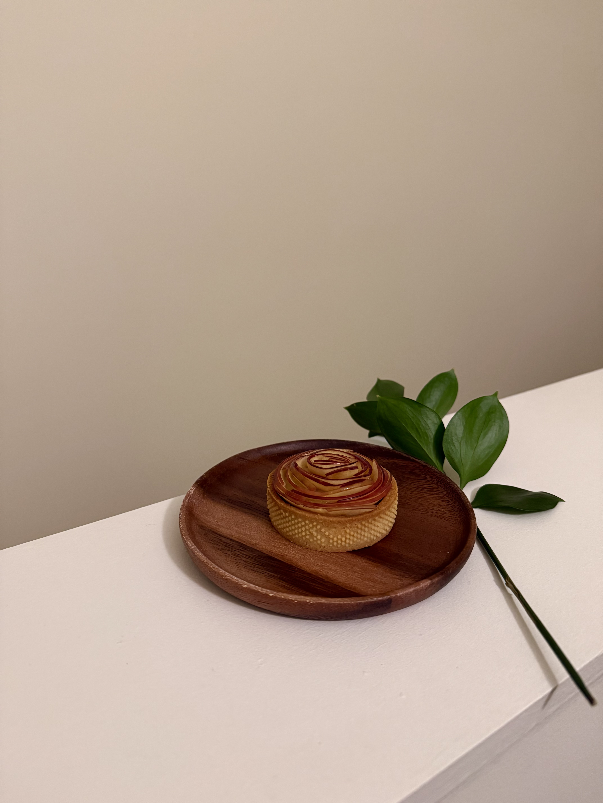
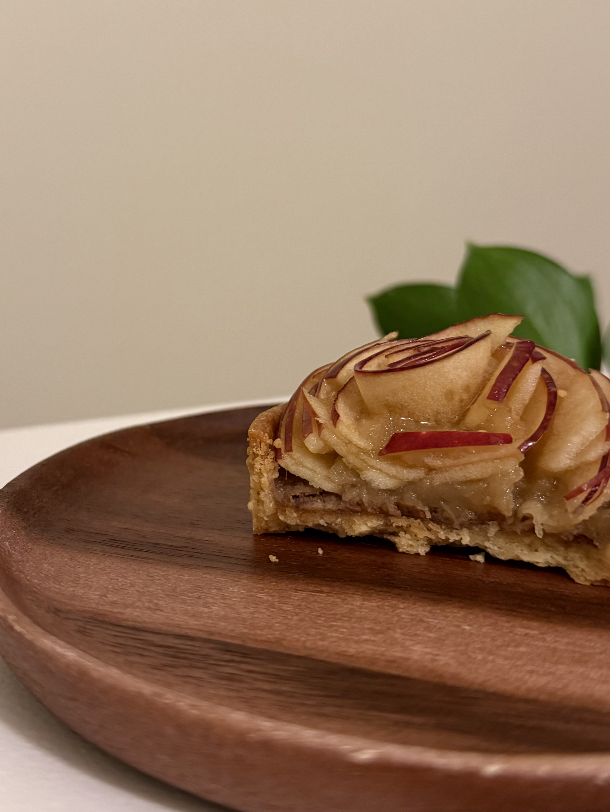

# Apple Tart

Size: approximately 10–12 tarts, 7 cm diameter

## Ingredients

### Tart Crust

- unsalted butter 135 g
- granulated sugar 57 g
- egg 45 g
- cake flour 225 g
- almond flour 57 g

### Frangipane

- unsalted butter 40 g
- caramelized walnuts 40 g
- whole egg 40 g
- granulated sugar 20 g
- almond flour 10 g

### Apple Marmalade

- apples 2
- granulated sugar 10 g

### Apple Petals

- apples 1.5
- unsalted butter 5 g

### Apple ganache

- apple puree 180 g
- white chocolate 80 g
- heavy cream 30 g
- cream cheese 44 g
- butter 44 g
- honey 6 g

