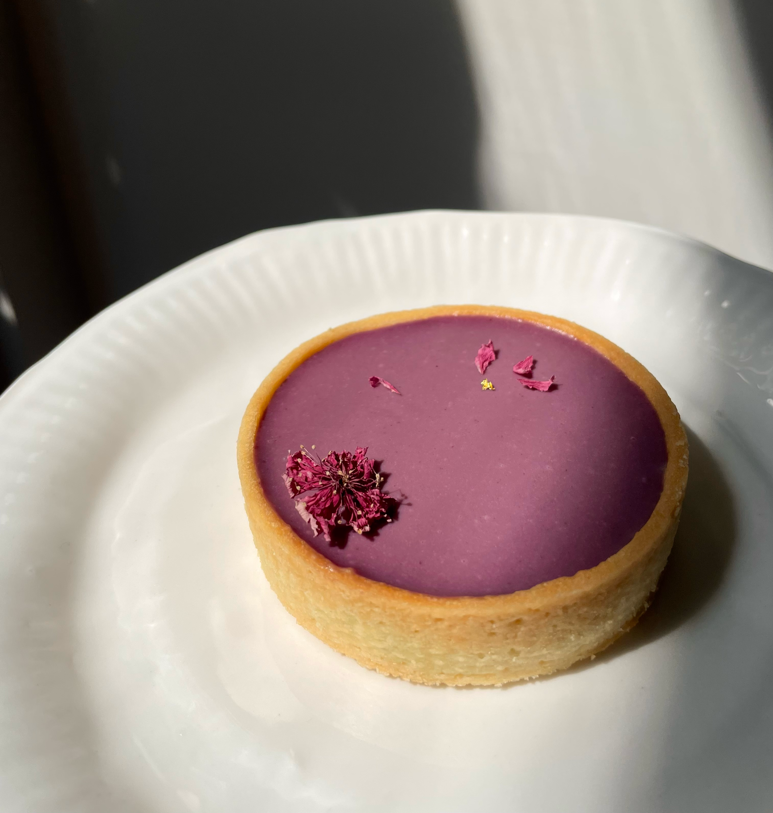
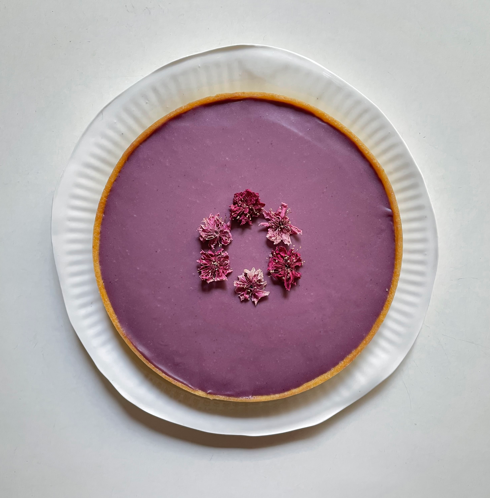

# Berry Brownie Tart

Size: 1 × 15 cm tart + approximately 3–4 × 8 cm tarts

## Ingredients

### Brownie

- dark chocolate 120 g
- butter 60 g
- eggs 2
- granulated sugar 60 g
- all-purpose flour 30 g
- sea salt flakes 2 pinches

### Blackberry Ganache

- white chocolate (Valrhona Ivoire 35%) 150 g
- blackberry purée 80 g
- heavy cream 50 mL
- lemon juice 10 mL

## Steps

1. Bake the tart shells at 175 °C for 10 minutes.
2. Add the brownie filling and bake for another 10 minutes.

