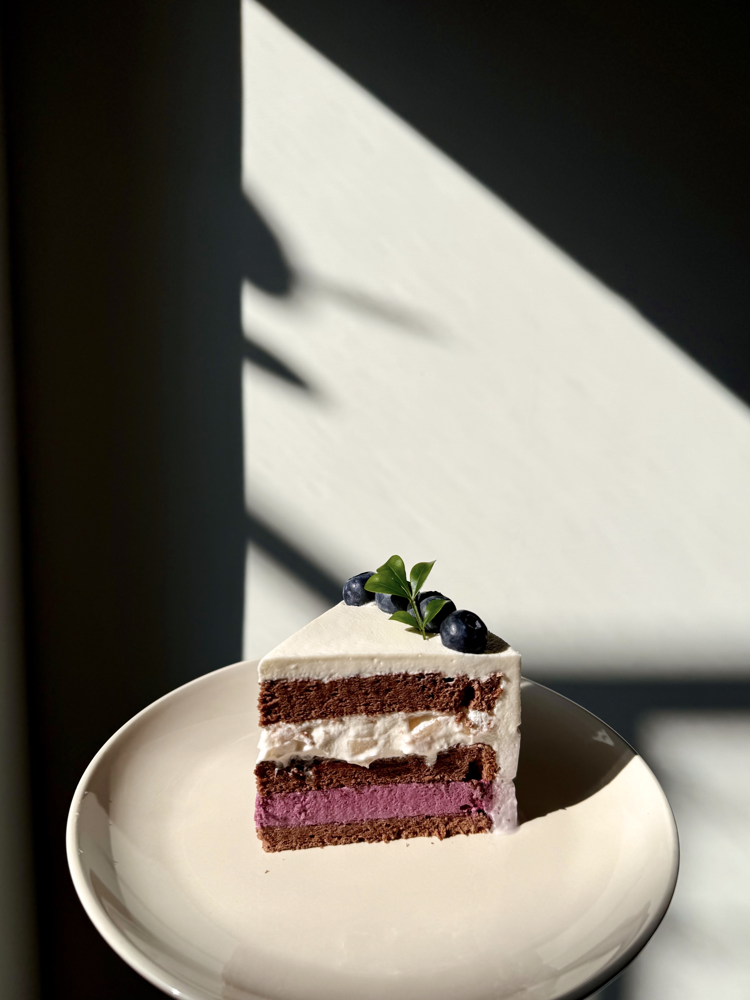

# BLueberry Cake

Size: 6-inch round mold

## Ingredients

### Chocolate Chiffon Cake

- cake flour 45 g
- unsweetened cocoa powder 15 g
- dark or bittersweet chocolate 15 g
- vegetable oil 30 g
- milk 40 g
- egg yolks 3
- egg whites 3
- lemon juice 1 tsp
- sugar 45 g

### Blueberry mousse layer

- blueberry purée 127 g
- granulated sugar 45 g
- lemon juice 9 g
- gelatin 5.5 g
- heavy cream 90 g

## Steps

1. Bake at 150 °C / 300 °F for 45 minutes

