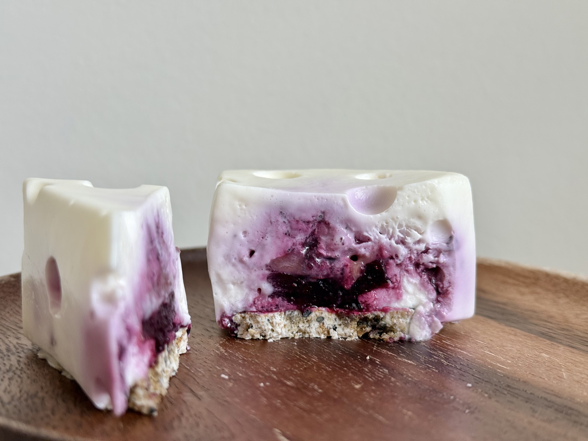
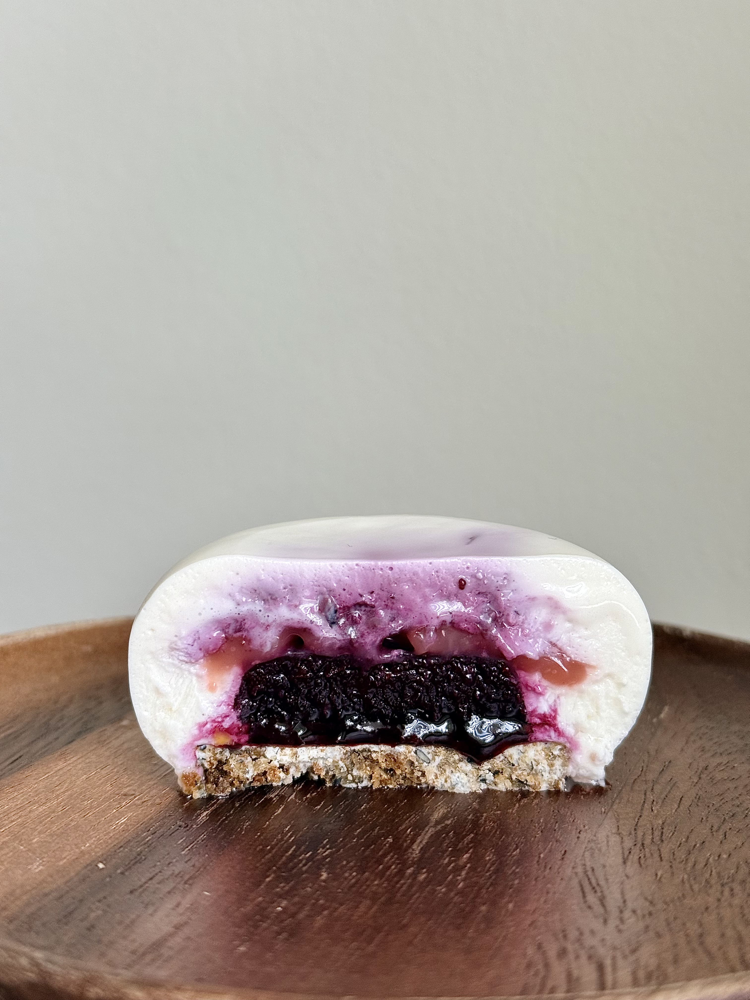

# Blueberry entremet

## Ingredients

### Sesame Streusel

- unsalted butter 40 g
- granulated sugar 40 g
- cake flour 40 g
- almond flour 30 g
- toasted white sesame seeds 15 g
- salt, a pinch

- baked sesame streusel 60 g
- white chocolate 35 g

### Blueberry Jelly

- blueberry purée 180 g
- granulated sugar 25 g
- lemon juice 10 g
- gelatin 3 g
- water 20 g

### Elderflower Marmalade

- elderflower preserve 100 g
- candied lemon peel, finely diced 10–20 g
- lemon juice 1–2 tsp
- elderflower liqueur, a splash

### Cheesecake Mousse

- cream cheese 150 g
- granulated sugar 38 g
- syrup 20 g
- honey Greek yogurt 60 g
- heavy cream 115 g
- lemon juice 1 tbsp
- water 30 g
- gelatin 3.5 g
- vanilla extract, as needed

### Blueberry Compote

- blueberry compote, as needed
- gelatin 0.5 g

## Steps

1. Mix all ingredients until they resemble coarse crumbs.
2. Spread on a baking tray.
3. Bake at 160 °C for 15–20 minutes, stirring once halfway through.
4. Cool completely. Then, break into small pieces.
5. Melt the white chocolate.
6. Mix with the sesame streusel.
7. Spread into a 2–4 mm layer in the mold.
8. Freeze until firm.

