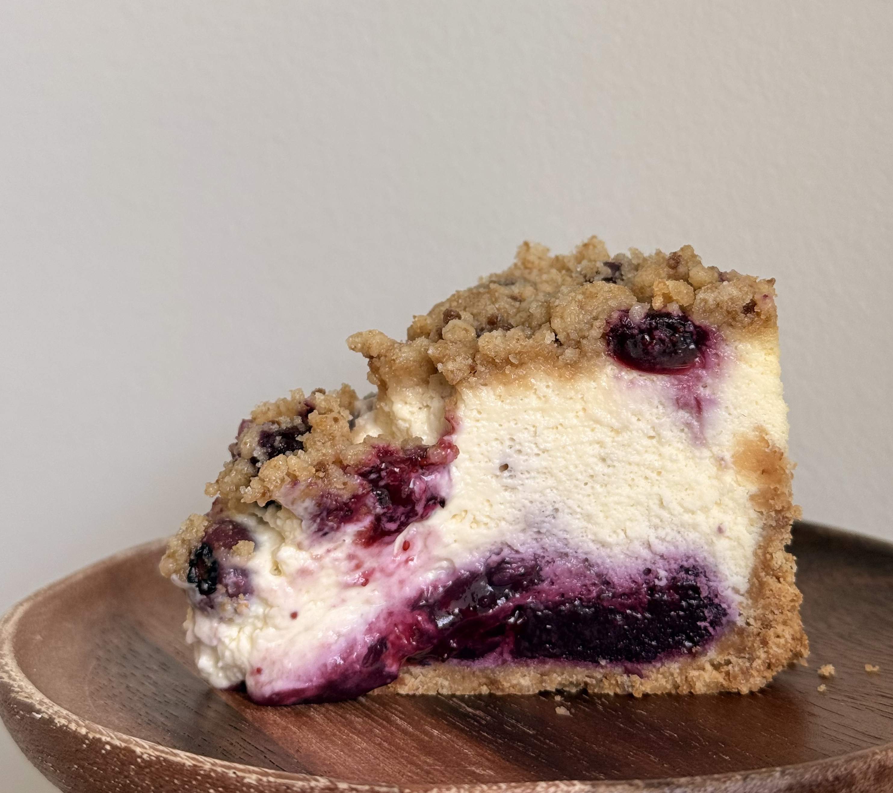

# Blueberry Crumble Cheesecake

Size: 15 cm round mold

## Ingredients

### Graham Cracker Crust

- graham crackers 100 g
- unsalted butter 45 g

### Crumble Topping

- almond flour 20 g
- cake flour 20 g
- granulated sugar 10 g
- brown sugar 10 g
- unsalted butter 20 g
- salt, a pinch

### Blueberry Compote

- blueberries 130 g
- granulated sugar 25 g
- lemon juice 8 g
- lemon zest
- cake flour 10 g
- water 15 g
- vanilla extract

### Cheesecake Filling

- cream cheese 300 g
- heavy cream 100 g
- honey Greek yogurt 60 g
- granulated sugar 50 g
- cake flour 20 g
- eggs 2
- lemon juice 1 tbsp
- vanilla extract 1 tsp
- salt, a pinch

## Steps

Graham Cracker Crust

1. Finely crush the graham crackers.
2. Mix with the melted butter.
3. Press firmly into the cake pan using the back of a spoon or a rolling pin.
4. Refrigerate until set.

Crumble Topping

1. Combine all ingredients and rub together quickly until crumbly.
2. Avoid warming or melting the butter.
3. Freeze until needed.

Cheesecake Filling

1. Let the cream cheese and heavy cream come to room temperature for about 1 hour.
2. Add the ingredients one at a time to a mixer or food processor, mixing after each addition.
3. Mix until smooth.

Assembly and Baking

1. Pour the cheesecake filling over the prepared crust.
2. Scatter some of the blueberry compote over the top.
3. Bake at 160 °C for 20 minutes.
4. Remove briefly from the oven and add more blueberry compote and the crumble topping.
5. Return to the oven and bake at 150 °C for another 20 minutes, or until set.
6. Refrigerate overnight.

