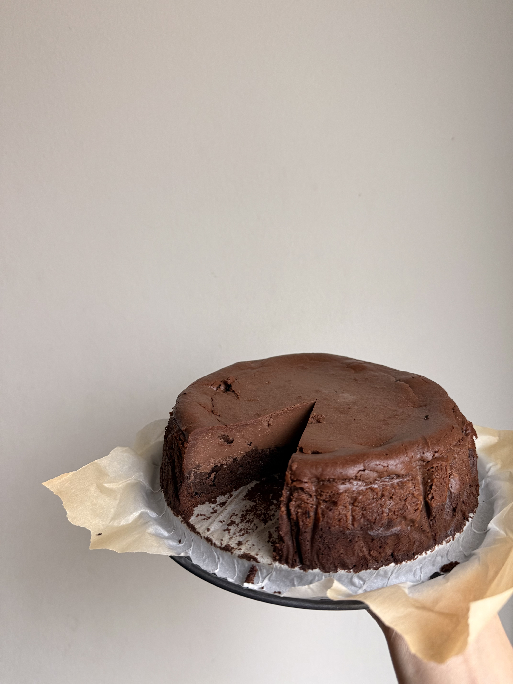

# Brownie Cheesecake

## Ingredients

### Brownie

- unsalted butter 48 g
- heavy cream 30 g
- dark chocolate 60 g
- egg yolk 2
- egg white 2
- brown sugar 30 g
- sugar 40 g
- cake flour 10 g
- cocoa powder 15 g

### Chocolate Cheesecake

- cream cheese 140 g
- sugar 35 g
- egg 42 g
- dark chocolate 45 g
- cocoa powder 5 g
- heavy cream 66 g
- vanilla extract 1.5 g
- salt 1 pinch
- lemon juice 3 g

## Steps

1. Bake at 220°C for 20-25 minutes

