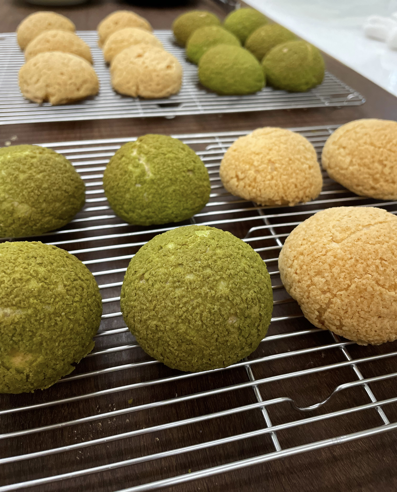

# Choux

Size: 20 choux, 3 cm diameter

## Ingredients

### Craquelin

- granulated sugar 50 g
- unsalted butter 50 g
- all-purpose flour 50 g
- matcha powder 4 g, optional
- vanilla extract 1 drop

Size: 4 cm diameter × 2 mm thick.

### Choux Pastry

- unsalted butter 44 g
- water 100 g
- salt 2.5 g
- all-purpose flour 80 g
- whole egg 118 g

### Crème Diplomat

- whole milk 250 g
- granulated sugar 50 g
- egg yolks 2
- cake flour 16 g
- unsalted butter 25 g
- vanilla bean paste 1 tbsp
- heavy cream 250 g

## Steps

1. Pipe the choux approximately 3 cm in diameter.
2. Place a 4 cm craquelin disc on top of each choux.
3. Bake at 170 °C for 20 minutes.
4. Reduce the temperature to 150 °C and bake for another 20 minutes.

