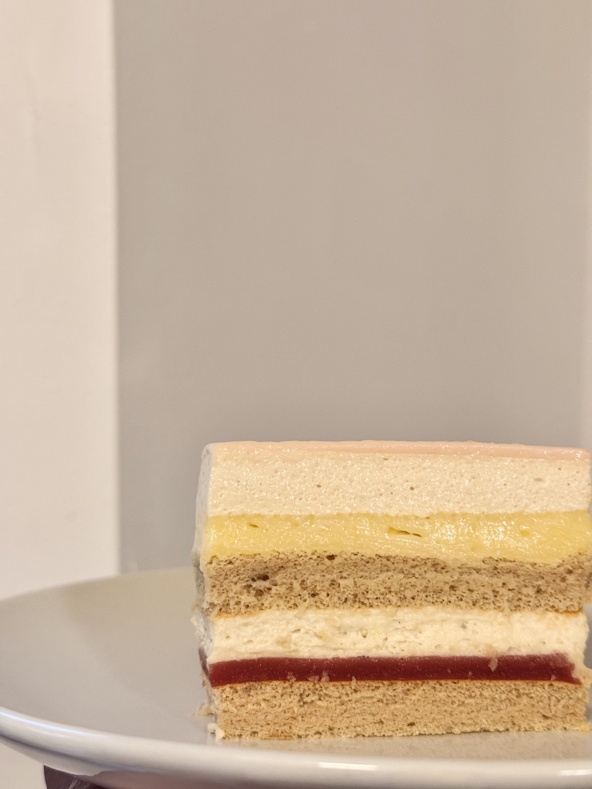

# Raspberry Sesame Cake

## Ingredients

### Elderflower Glaze

- water 20 g
- white chocolate 20 g
- elderflower jam 20 g
- gelatin sheet 1 g

### Sesame Mousse

- heavy cream 250 g
- syrup or granulated sugar 20 g
- sesame paste 70 g
- milk 80 g
- gelatin 5 g

### Elderflower and Raspberry Jelly

- elderflower jam 80 g
- raspberry purée 20 g
- lemon juice 10 g
- gelatin 2 g

### Lemon Curd

### Earl Grey Chiffon Cake

