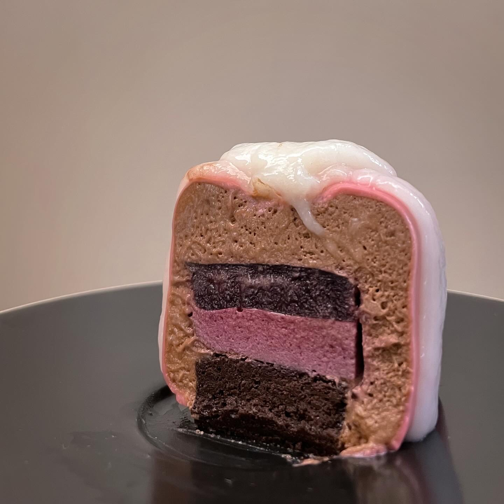

# Mousse entremet

## Ingredients

### Chocolate cake

- egg white 1
- egg yolk 1
- sugar 12 g
- milk 7.5 g
- dark chocolate 20 g
- butter 7.5 g
- cocoa powder 10 g
- vanilla extract 1 drop
- salt 1 pinch

### Red berry jelly

- red berry purée 50 g
- water 50 g
- gelatin 4.5 g

### Red berry mousse

- gelatin 2.1 g
- raspberry purée 40 g
- heavy cream 60 g
- powder sugar 10 g

### Dark chocolate mousse

- sugar 54 g
- milk 12 g
- yolk 36 g
- dark chocolate 135 g
- gelatin 2.6 g
- heavy cream 225 g

### Mirror glaze

- Berry purée
- granulated sugar 100 g
- sweetened condensed milk 70 g
- water 90 g
- gelatin 7 g
- white chocolate 115 g
- red food coloring

### The red mirror glaze

- sugar 80 g
- water 80 g
- glucose syrup 80 g
- condensed milk 80 g
- gelatine 5 g
- white chocolate 80 g
- red food coloring

## Steps

1. Bake at 180 °C for 8 minutes in a 9cm \* 12cm tray

