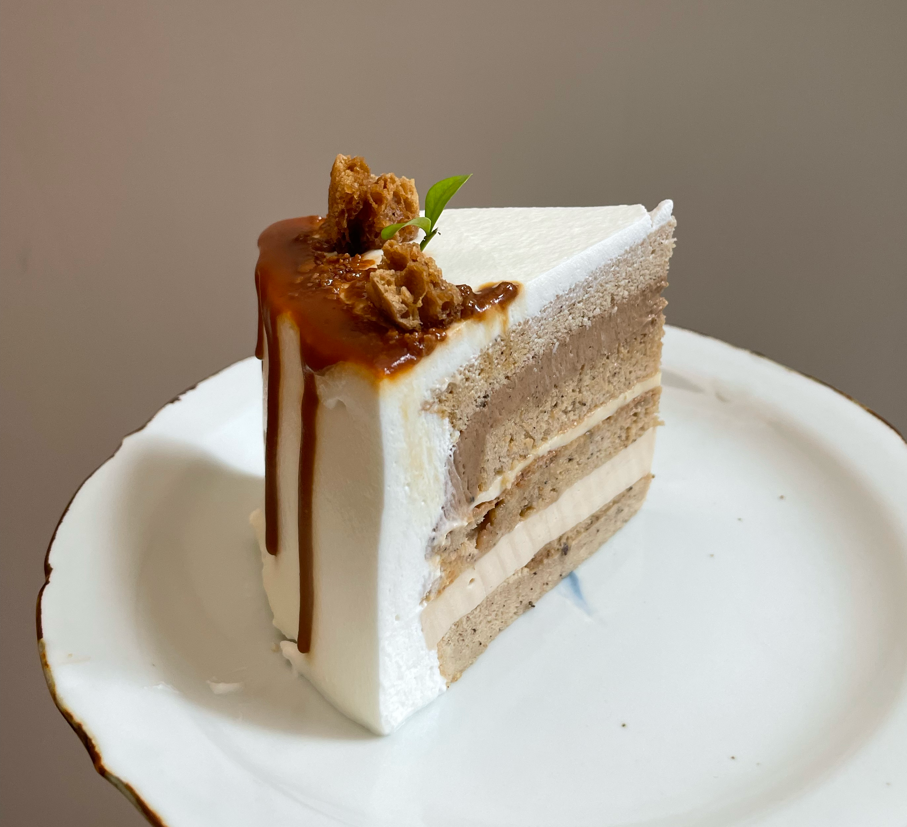

# Earl Grey Milk Tea Cake

## Ingredients

### Earl Grey Chiffon Cake

- egg yolks 3
- egg whites 3
- cake flour 50 g
- vegetable oil 35 mL
- Earl Grey milk tea 40 mL
- granulated sugar 45 g
- lemon juice, a few drops

### Earl Grey Custard 

- whole milk 175 g
- Earl Grey tea leaves 2.5 g
- egg yolks 1.5
- granulated sugar 30 g
- vanilla bean paste 2 g
- cornstarch 10 g
- gelatin 1 g

### Earl Grey Cheese Mousse

- cream cheese 140 g
- granulated sugar 25 g
- gelatin 4 g
- heavy cream (lightly whipped) 40 g
- milk 30 g
- Earl Grey tea bag 1

### Custard Pudding

- egg yolk 1
- granulated sugar 24 g
- milk 108 mL
- heavy cream 36 mL
- vanilla extract 1 tsp
- gelatin 4.2 g

## Steps

1. Bake at 150 °C for 30–35 minutes.

