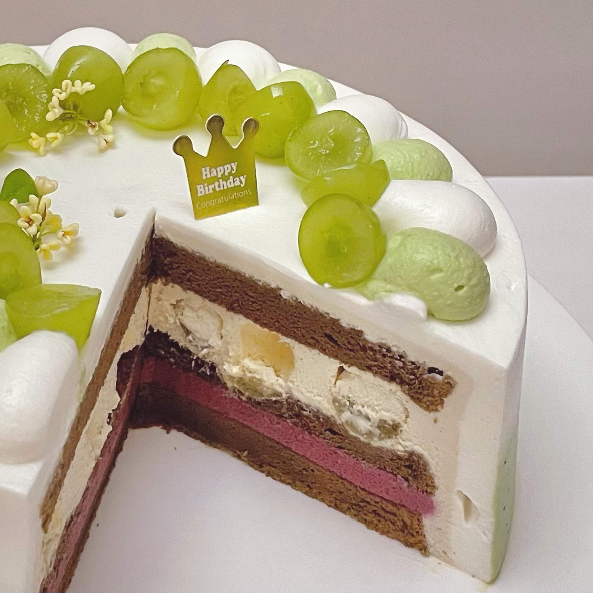

# Matcha Cake

## Ingredients

### Hojicha Chiffon Cake

- hojicha powder 10 g
- milk 45 g
- cake flour 50 g
- corn oil 30 g
- egg yolks 3
- egg whites 3
- granulated sugar 40 g
- lemon juice 1 g

### Raspberry Mousse

- gelatin 2.5 g
- raspberry purée 70 g
- heavy cream 70 g
- powdered sugar 13 g

## Steps

1. Bake at 170 °C for 30 minutes.

