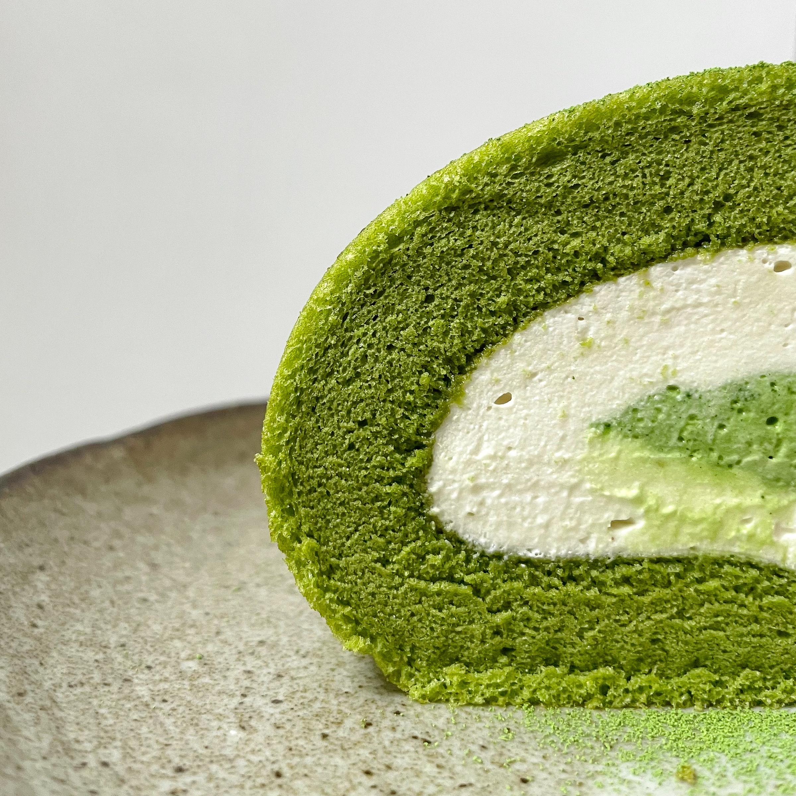
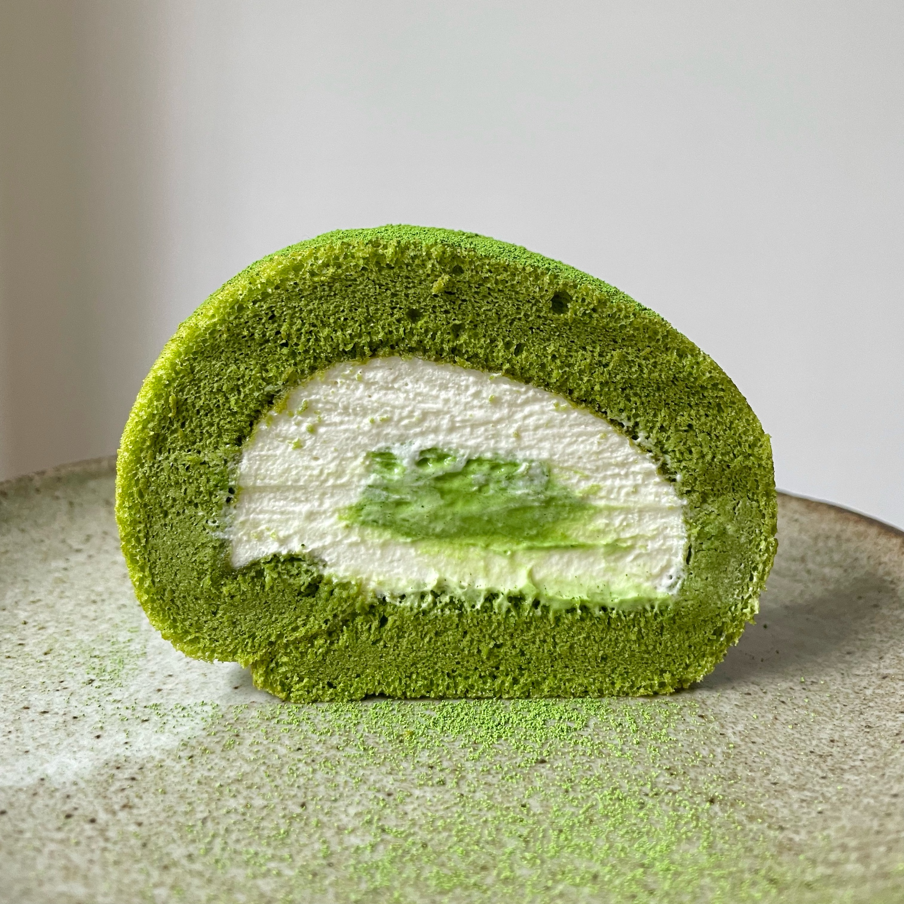

# Matcha Roll

Size: 26 × 26 cm baking tray

## Ingredients

### Cake Roll Sponge

- corn oil 36 g
- matcha powder 7.2 g
- milk 52 g
- egg yolks 64 g (about 4)
- egg whites 120 g (about 4)
- cake flour 44 g
- granulated sugar 48 g

### Jasmine Cream Filling

- jasmine-infused cream 120 g
- heavy cream 48 g
- granulated sugar 12 g

For the jasmine-infused cream:

- heavy cream 160 g
- jasmine tea 4 g

## Steps

1. Bake at 155 °C for 30 minutes.
2. Spread the cream more thickly along the edge where you will begin rolling.
3. If adding a central filling, place it near the starting edge of the roll.

