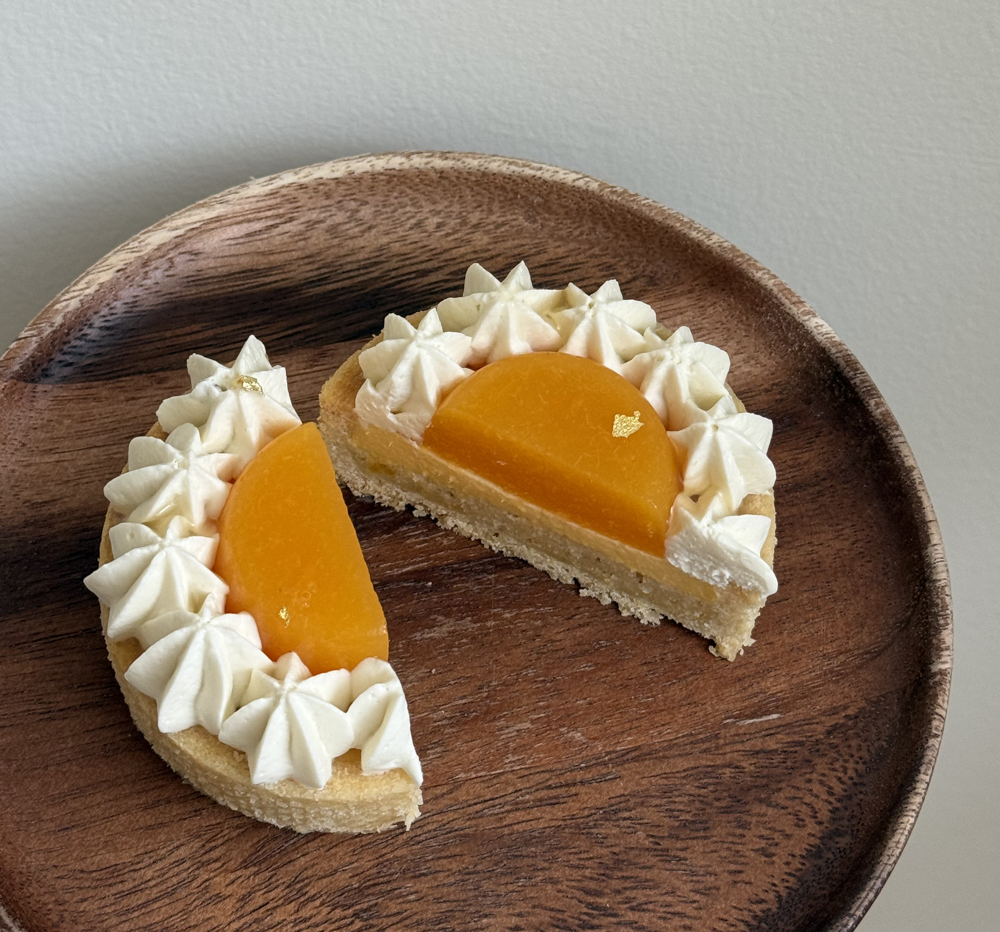
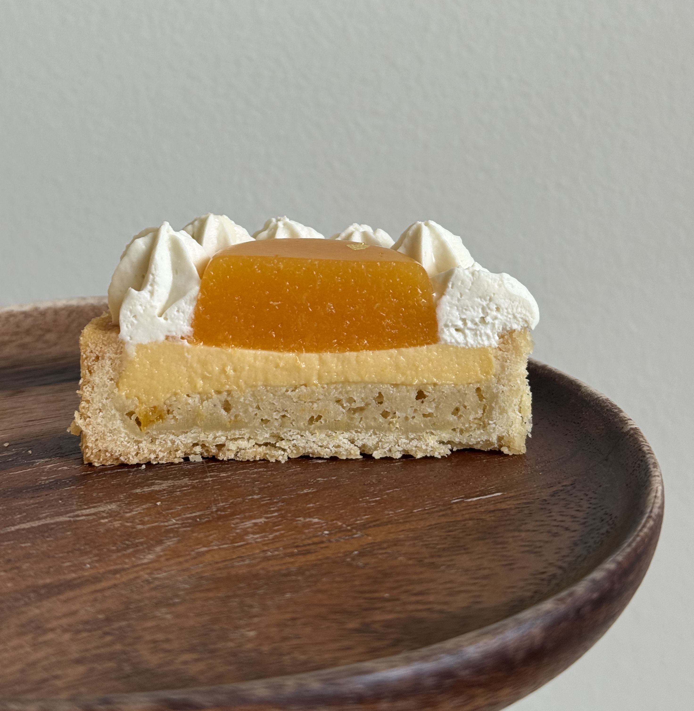

# Peach Jasmine Tart

Size: 20 tarts, 7 cm diameter

## Ingredients

### Tart Crust

- unsalted butter 135 g
- granulated sugar 57 g
- egg 45 g
- all-purpose flour 225 g
- almond flour 57 g

### Peach Purée

- peaches 750 g, about 5 large
- granulated sugar 30 g

### Jasmine Cream

- gelatin 2 g
- heavy cream 250 g, infused from 280 g
- jasmine tea leaves 7 g
- white chocolate 50 g
- mascarpone 70 g
- heavy cream 50 g, added after chilling

### Peach Financier Layer

- unsalted butter 50 g
- almond flour 45 g
- powdered sugar 45 g
- all-purpose flour 18 g
- peach purée 45 g
- egg whites 60 g
- peach 1, finely diced
- salt, a pinch
- vanilla extract 1 drop
- lemon juice 3 g

### Peach Crémeux

- peach purée 200 g
- egg yolks 50 g
- granulated sugar 33 g
- gelatin 3.3 g
- unsalted butter 58 g

## Steps

1. Bake the tart shells at 175 °C / 350 °F for 10 minutes.
2. Add the peach financier filling.
3. Bake at 160 °C / 320 °F for another 25 minutes.

