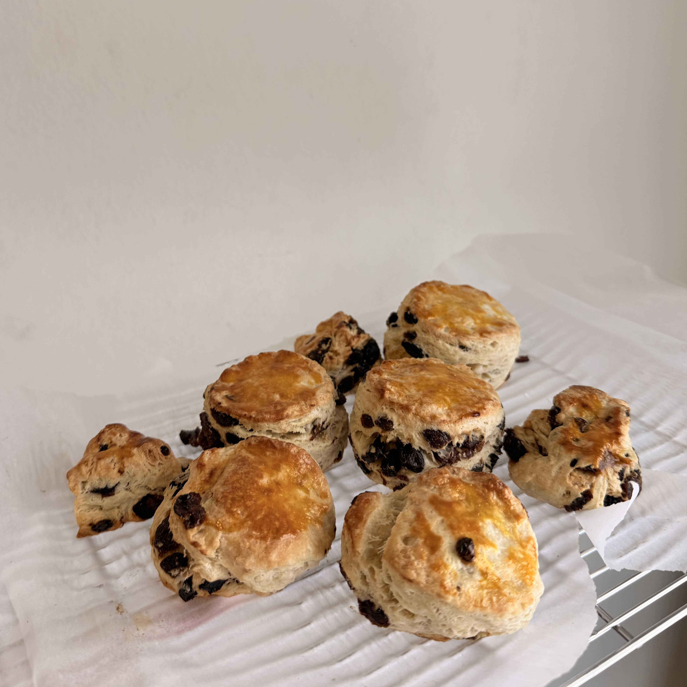

# Scone

Portion: 8 scones

## Ingredients

### Scone

- all-purpose flour 200 g
- granulated sugar 40 g
- salt 2 g
- baking powder 5 g
- unsalted butter 55 g
- milk 85 g
- egg 30 g
- raisin

### Egg Wash

- egg yolk

## Steps

1. Cut the scones with a 5.3 cm round cutter.
2. Brush the tops with egg yolk.
3. Bake at 180 °C for 20 minutes.

